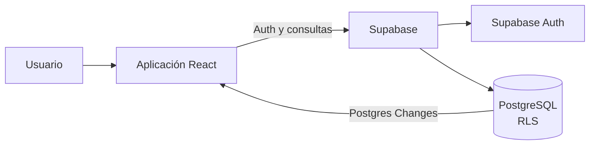

# Recordatorios

Aplicación web para organizar listas de recordatorios, componentes y acciones por categorías.

## Descripción

Recordatorios permite a cada usuario crear listas para organizar equipaje, tareas recurrentes o proyectos. Los datos se guardan en Supabase y los cambios se reciben en tiempo real. La interfaz y los flujos de uso están en español.

## Funcionalidades

- Registro e inicio de sesión con correo y contraseña.
- Crear y eliminar listas con título y descripción opcional.
- Añadir categorías y filtrar elementos por una o varias categorías.
- Gestionar componentes con cantidad y acciones con fecha límite opcional.
- Marcar elementos como completados, editarlos, eliminarlos o reiniciar el estado de toda una lista.
- Exportar el contenido visible de una lista como archivo de texto `.txt`.
- Actualizar la interfaz en respuesta a cambios de listas, categorías y elementos mediante Supabase Realtime.
- Incluye un manifiesto y recursos gráficos PWA. No se configura un service worker ni funcionamiento sin conexión.

## Arquitectura y tecnologías

| Área | Tecnología |
|---|---|
| Interfaz | React 19 + TypeScript 5 |
| Herramienta de desarrollo y build | Vite 6 |
| Estilos | Tailwind CSS 4 mediante el plugin de Vite |
| Iconos | Lucide React |
| Backend y acceso a datos | Supabase JavaScript Client 2 |
| Base de datos | PostgreSQL en Supabase |
| Autenticación | Supabase Auth (correo y contraseña) |
| Autorización | Row Level Security (RLS), definida en `schema.sql` |
| Actualizaciones en tiempo real | Supabase Realtime (Postgres Changes) |
| Hosting y CI/CD | GitHub Pages mediante GitHub Actions |
| Calidad | TypeScript en modo estricto; no se configura un linter ni formateador |

La aplicación es una SPA: los componentes React gestionan el estado de la interfaz y se comunican directamente con Supabase usando `@supabase/supabase-js`. Supabase Auth proporciona la sesión; las consultas a PostgreSQL usan esa sesión y las políticas RLS limitan el acceso a las listas propias del usuario. Los datos persistentes residen en PostgreSQL; no hay persistencia local offline ni una API propia o funciones Edge en este repositorio.



## Estructura del proyecto

```text
.
├── .github/workflows/deploy.yml  # Build y publicación en GitHub Pages
├── public/                       # Manifiesto, iconos e imágenes de la app
├── src/
│   ├── components/
│   │   ├── AuthView.tsx           # Registro e inicio de sesión
│   │   ├── ListsOverview.tsx      # Vista y gestión de listas
│   │   └── ListDetail.tsx         # Categorías, elementos y exportación TXT
│   ├── lib/supabase.ts            # Cliente Supabase y tipos de datos
│   ├── App.tsx                    # Sesión, datos y coordinación de vistas
│   ├── index.css                  # Entrada de Tailwind CSS
│   └── main.tsx                   # Punto de entrada React
├── schema.sql                     # Tablas, políticas RLS y publicación Realtime
├── package.json                   # Dependencias y scripts npm
├── package-lock.json              # Versiones fijadas para npm
├── tsconfig.json                  # Configuración TypeScript
└── vite.config.ts                 # Configuración Vite, React y Tailwind
```

## Requisitos previos

- Node.js 20 (versión usada por el workflow de despliegue).
- npm, incluido con Node.js.
- Git.
- Un proyecto de Supabase para ejecutar la aplicación con autenticación y persistencia.

## Instalación y ejecución local

```bash
git clone https://github.com/ASM-LAB/lista-recordatorio.git
cd lista-recordatorio
npm ci
```

### Configurar Supabase

1. Crea o selecciona un proyecto de Supabase.
2. En el SQL Editor del proyecto, ejecuta el contenido de [`schema.sql`](./schema.sql) una vez para crear las tablas, políticas RLS y habilitar las tablas en Realtime.
3. Crea `.env.local` en la raíz del proyecto (puedes copiar `.env.example`) y define allí estas variables con los datos del proyecto:

   ```dotenv
   VITE_SUPABASE_URL=https://<project-id>.supabase.co
   VITE_SUPABASE_PUBLISHABLE_KEY=sb_publishable_...
   ```

   Puedes obtenerlas en la configuración de API del proyecto Supabase. `.env.local` se usa al ejecutar y compilar la aplicación localmente; no lo subas a Git.
4. Para desplegar en GitHub Pages, define las mismas variables como **Actions variables** del repositorio en **Settings → Secrets and variables → Actions → Variables**. El workflow las valida y las utiliza durante el build. También puedes definirlas en el entorno `github-pages` configurado por el workflow.
5. La clave publishable se incluye en la app del navegador y es pública; la seguridad depende de RLS. Nunca uses una clave `secret` o `service_role` en el cliente.

> **Nota de configuración:** Vite expone al navegador las variables con prefijo `VITE_`; por eso la clave debe ser publishable, nunca una clave secreta. `.env.local` está excluido de Git y `.env.example` solo contiene valores de ejemplo. Si cambias `.env.local` mientras el servidor está activo, reinicia `npm run dev`.

La aplicación presenta registro e inicio de sesión. La disponibilidad del registro de usuarios depende de la configuración de Auth del proyecto Supabase.

Inicia el servidor de desarrollo:

```bash
npm run dev
```

Abre en el navegador la dirección local que indique Vite, normalmente <http://localhost:5173>. Con `.env.local` configurado y el esquema aplicado en Supabase, podrás registrarte/iniciar sesión y probar las listas; los datos se guardan en el proyecto Supabase configurado.

## Uso

1. Regístrate o inicia sesión con correo y contraseña. La contraseña debe tener al menos seis caracteres en el formulario.
2. Crea una lista desde **Nueva Lista** e incluye una descripción si lo deseas.
3. Abre la lista para añadir categorías, componentes o acciones.
4. Asigna elementos a categorías o marca que aplican a todas. Los componentes admiten cantidad; las acciones, fecha límite.
5. Filtra la vista por categorías y marca elementos completados según avances.
6. Usa **Reiniciar Lista** para desmarcar todos los elementos o **Exportar TXT** para descargar el contenido mostrado.

La exportación respeta el filtro de categorías activo y conserva los estados de completado; no genera hojas de cálculo.

## Base de datos y backend

`schema.sql` define el esquema para Supabase/PostgreSQL:

| Tabla | Propósito |
|---|---|
| `lr_lists` | Listas asociadas a `auth.users` mediante `user_id` |
| `lr_categories` | Categorías de una lista; el nombre es único por lista |
| `lr_list_items` | Componentes y acciones, incluyendo cantidad, fecha límite y estado |
| `lr_item_categories` | Relación muchos-a-muchos entre elementos y categorías |

Las claves foráneas eliminan en cascada categorías y elementos asociados al eliminar su lista. RLS está habilitado en las cuatro tablas: las políticas de listas comprueban `user_id`; las de categorías y elementos comprueban la lista propietaria; y la política de la tabla relacional comprueba la lista del elemento asociado. La publicación `supabase_realtime` incluye las cuatro tablas para notificar cambios al cliente.

No hay migraciones versionadas, datos seed, funciones Edge, buckets de Storage ni herramientas de backup en el repositorio. Para aplicar el esquema, usa el SQL Editor de Supabase; el script está pensado para inicializar el esquema y sus políticas, no como migración repetible en una base que ya lo tenga aplicado.

## Scripts y comprobaciones

| Comando | Descripción |
|---|---|
| `npm run dev` | Inicia Vite en modo desarrollo. |
| `npm run build` | Ejecuta la comprobación TypeScript (`tsc`) y crea el build de producción en `dist/`. |
| `npm run preview` | Sirve localmente el build de `dist/` para previsualizarlo. |

No hay scripts ni configuración para pruebas unitarias, integración, extremo a extremo, lint o formato. Para validar cambios disponibles actualmente, ejecuta:

```bash
npm ci
npm run build
```

## Build y despliegue

Genera y previsualiza la versión de producción:

```bash
npm run build
npm run preview
```

El workflow [`.github/workflows/deploy.yml`](./.github/workflows/deploy.yml) publica `dist/` en GitHub Pages. Se ejecuta con `workflow_dispatch` o al hacer push a la rama `lista_preliminar`; usa Node.js 20, `npm ci` y `npm run build`. Antes del build comprueba que estén definidas las variables `VITE_SUPABASE_URL` y `VITE_SUPABASE_PUBLISHABLE_KEY` en GitHub Actions. El despliegue requiere GitHub Pages habilitado y permisos Pages configurados para el repositorio.
